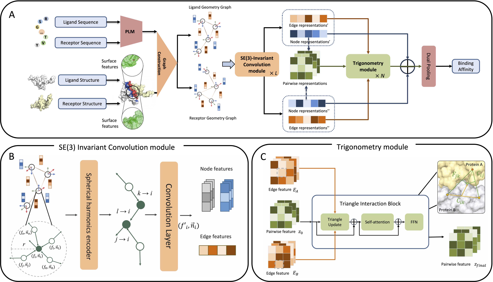

# Introduction
TriGeo-PPB is a protein–protein binding affinity prediction framework that integrates pretrained protein language model embeddings, SE(3)-invariant geometric encoding, and trigonometry-aware cross-protein interactions through a dual pool readout to improve generalization under low-homology conditions.


# Dataset
Original PPB-affiinty dataset can be download on https://zenodo.org/doi/10.5281/zenodo.11070823. Our data can be obtained in /dataset.

# System requirement
TriGeo-PPB is mainly based on the following packages:  

torch 2.0.1  
dgl-cu117 0.9.1  
torch-scatter 2.1.1  
e3nn 0.5.1  
numpy 1.25.2  
pandas 2.0.3  
scipy 1.11.1  
scikit-learn 1.2.2  
atom3-py3 0.1.9.8  
fair-esm 2.0.1  
pykeops 2.1.2  

And all dependencies can be found in requirements.txt.

# Feature Generate and Graph Construction

First, we need to prepare esm2_t33_650M_UR50D model from https://github.com/facebookresearch/esm

And then, we can simply run the following script to get the feature and graph of protein complex.
```
python script/feature_generate/feature_generate.py \
  --pdb example/6LE5_A_B.pdb \
  --receptor-chains A \
  --ligand-chains B \
  --name 6le5 \
  --esm-model /esm2checkpoints/esm2_t33_650M_UR50D.pt \
  --output-dir outputs/example/features \
  --device cuda:0
```

# Run TriGeo-PPB for prediction

We can also run the following script directly to predict protein-protein binding affinity.

``` 
python script/predict.py \
  --pdb ./example/6LE5_A_B.pdb \
  --receptor-chains A \
  --ligand-chains B \
  --output-dir outputs/example/ \
  --device cuda:0
```